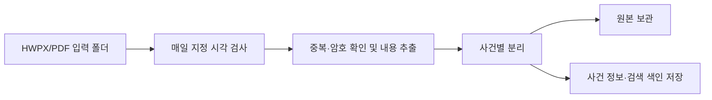

# 설계서 초안

## 1. 세 가지 관점의 흐름

### 신규 사건 저장



입력 폴더 → 새 파일 검사 → 내용 추출·사건별 분리 → 원본 보관과 사건 정보·검색 색인 저장

### 평가 및 반영


사용자 평가 → 오류 원인 진단 → 개선안 시험 → 결과 비교 → 검증된 변경만 반영

### 사용


질문 접수 → 대기 목록에 한 줄 요약 표시 → 한 건씩 검색·비교 → 사건번호·결정·원문 근거를 포함한 답변 표시

### 단계별 데이터 처리

| 단계 | 입력 | 처리 결과 |
| --- | --- | --- |
| 문서 등록 | 입력 폴더의 새 HWPX·PDF | 보관된 원본과 등록 상태 |
| 사건 정리 | 문서 본문·목차·사건번호 | 사건별 정보와 원문 위치 |
| 검색 준비 | 사건별 정보와 본문 | 문장·임베딩 검색 색인 |
| 질문 처리 | 사용자의 자연어 질문 | 유사 사건 후보와 조건별 비교 |
| 답변 표시 | 후보 사건과 원문 근거 | 사건번호·내용·결정·유사점·차이점·근거 |
| 품질 개선 | 사용자 평가와 이전 결과 | 검증된 검색·답변 설정 변경 |

## 2. 문서 등록과 저장

설정 파일에는 입력 폴더, 보관 폴더, 매일 검사할 시각을 둔다. 공통 문서 암호는 별도의 비밀 설정 또는 환경변수로 관리하고 Git 추적에서 제외한다. 검사는 새 파일만 대상으로 하되 파일명만으로 중복을 판정하지 않고 내용 식별값도 확인한다. 파일 쓰기가 끝나기 전에 읽지 않도록 안정 상태를 확인한다.

등록 과정은 형식 판별, 필요 시 암호 해제, 원문 텍스트·표·쪽 위치 추출, 문서 유형 분류, 사건별 분리, 사건 정보 및 검색 색인 생성 순서로 진행한다. 성공한 원본은 보관 폴더로 이동하고, 실패한 파일은 오류 사유와 함께 재처리 가능한 상태로 남긴다. 추출 결과가 불완전한 사건은 정상 사례처럼 검색에 노출하지 않는다.

원본 파일, 사건 정보, 검색 색인을 분리해 저장한다. 사건 정보에는 문서 식별값, 원본 경로, 사건번호, 제목·분류, 핵심 사실, 원처분과 결정 결과, 본문 구획, 근거 문단, PDF 쪽 또는 HWPX 내 위치, 추출 상태를 포함한다. 책자형 문서 하나에서 여러 사건 레코드가 만들어진다. 문서가 교체되거나 삭제되면 해당 사건과 색인의 관계도 갱신한다.

### 2.1 DB 선택 제안과 이유

우선 제안은 PostgreSQL에 pgvector 확장을 더하는 구성이다. 서버 OS는 Windows 11로 확정했다. 개발 PC의 동일한 Windows 11 시험 환경에서 사용할 PostgreSQL·pgvector 버전과 오프라인 설치 묶음을 먼저 검증하고, 폐쇄망 서버에서는 반입 파일의 무결성, 확장 설치, 임베딩 저장·유사도 검색, 백업·복원을 최종 확인한다. 최종 DB 조합은 대표 질문의 검색 성능과 운영·백업 편의성까지 비교한 뒤 결정한다. 두 구성 요소 모두 PostgreSQL License로 기관에서 사용료 없이 사용할 수 있다.

| 저장 대상 | 우선 제안 | 선택 이유 |
| --- | --- | --- |
| 원본 HWPX·PDF | 서버의 보관 폴더 | 원문 파일을 그대로 보존하고 문서 백업·재처리를 쉽게 하기 위해 |
| 문서·사건 정보와 원문 위치 | PostgreSQL | 한 책자의 여러 사건과 원본 파일의 관계를 정확히 기록하기 위해 |
| 검색용 문단·임베딩 | PostgreSQL + pgvector | 사건 정보와 벡터를 연결하고 별도 벡터 DB 운영을 줄이기 위해 |
| 질문 대기열·처리 상태·사용자 질문·시스템 답변·피드백·튜닝 이력 | PostgreSQL | 운영 기록과 검색·답변 설정을 개선할 자료를 서버 재시작 후에도 유지하기 위해 |
| 평가용 질문·기대 정답·승인 상태 | 하나의 Excel 파일 | 운영 피드백과 분리된 평가 자료를 관리자가 검토·승인하기 위해 |

<span style="color:red">관리자가 사용자 질문·답변 데이터의 보존 기간을 설정할 수 있고, 보존 기간이 지나면 선택하여 삭제하거나 익명화할 수 있도록 한다.</span>

대안으로 SQLite는 단일 PC의 소규모 시범 운영에 설치·파일 백업이 단순하다. 다만 현재 요구인 여러 사용자 접속, 지속되는 질문 대기열, 벡터 검색을 함께 구성할 때는 별도 구성과 동시 접근 검증이 필요하다. PostgreSQL과 별도의 벡터 DB를 조합하면 벡터 검색 기능을 독립 운영할 수 있지만 서비스와 백업 대상이 늘고 사건 정보와 벡터의 일치 상태를 관리해야 한다. 따라서 현재 규모에서는 PostgreSQL + pgvector를 먼저 검토한다.

실제 운영 조건에서 SQLite 또는 별도 벡터 DB가 더 단순하거나 안정적이라는 근거가 나오면, 설치·백업·복구·동시 접속·검색 속도·무료 이용 조건을 비교해 다른 DB안을 다시 제안한다. <a href="https://www.postgresql.org/about/licence/">PostgreSQL 라이선스</a>와 <a href="https://github.com/pgvector/pgvector/blob/master/LICENSE">pgvector 라이선스</a>를 확인 자료로 둔다.

### 2.2 개발 자료와 시험 산출물의 Git 제외

외부망 개발 PC에서는 공개·가상 샘플만 사용한다. 공개 여부와 관계없이 개발용 샘플 파일은 소스 코드 저장소와 배포용 `release/` 밖의 별도 데이터 폴더에 보관하고 Git에 올리지 않는다. 시험 중 생성한 DB와 DB 덤프, 검색 색인·임베딩, 질문·답변·평가 결과, 로그·오류 보고서·백업도 같은 원칙으로 분리한다. 실제 운영 자료는 폐쇄망 서버에서만 생성·보관한다.

구현 시 개발·운영 데이터 경로를 실행 설정으로 분리하고, 개발용 데이터·시험 산출물·전송 묶음 경로를 `.gitignore`에 등록한다. GitHub에는 소스 코드와 개발·배포 정의, 정적 웹 화면, 비밀값 없는 설정 예시, 공개 가능한 설계 문서만 올린다. 커밋·푸시 전에는 추적·스테이징된 파일과 `docs/`에 데이터가 섞이지 않았는지 확인한다. `.gitignore`는 이미 추적된 파일과 과거 Git 이력을 지우지 못하므로 파일 목록 점검을 함께 수행한다. <a href="https://docs.github.com/en/get-started/git-basics/ignoring-files">GitHub 파일 제외 안내</a>.

## 3. 질문과 검색

질문은 웹에서 자연어로 접수한다. 검색은 사건 유형·핵심 사실·결과 등의 표현을 이용한 문장 검색과, 표현이 달라도 내용이 가까운 사건을 찾는 임베딩 검색을 결합한다. 사건번호, 인명사고 유무, 대물사고 유무처럼 결론에 영향을 줄 조건은 유사성 판단에서 분리해 비교한다.

검색 후보를 사건 단위로 다시 정렬하고, 각 후보의 일치 조건과 다른 조건을 함께 확인한다. 답변 생성 모델에는 선택된 원문 근거와 출처 위치만 전달한다. 답변은 사건별 사건번호·사건내용·결정 결과·유사점·차이점·근거를 보여준다. 충분한 근거가 없으면 해당 항목을 확인할 수 없다고 표시한다. 결과에서 보관된 원문을 열어 검증할 수 있어야 한다.

### 3.1 검색 기술 제안과 선택 이유

아래 조합은 현재 자료 규모와 운영 조건을 바탕으로 한 제안이며 확정 기술 목록이 아니다. 실제 HWPX·PDF 추출 결과와 대표 질문 평가에 따라 다시 선택한다. `Fuse`는 Fuse.js를 뜻하는 것으로 해석했다.

| 역할 | 우선 제안 | 선택 이유 |
| --- | --- | --- |
| 사건 정보와 상태 저장 | PostgreSQL | 사건·원문 위치·질문 대기열·평가·변경 이력을 한곳에서 관리하고, 20명 접속과 일일 문서 등록을 처리하기 위해 |
| 정확한 조건 확인 | 사건번호와 구조화된 사실 항목의 정확 검색 | 인명사고 없음, 대물사고 있음처럼 결과를 좌우하는 조건을 유사도 점수만으로 판단하지 않기 위해 |
| 한글 문구 검색 | Kiwi 형태소 분석 + BM25 | 한글 사건 표현의 주요 단어를 추출하고, 드문 핵심 단어가 포함된 사건을 상위에 올리기 위해 |
| 의미 검색 | 임베딩 모델 + pgvector | 단어가 달라도 의미가 비슷한 사건을 찾고 벡터를 사건 정보와 연결해 관리하기 위해 |
| 후보 결합 | RRF | BM25와 임베딩의 점수 단위가 달라 순위를 기준으로 결합하기 위해 |
| 최종 후보 확인 | 조건별 일치·차이 비교 | 비슷한 주제라도 중요한 사실이 다른 사건을 답변에서 구별하기 위해 |

초기에는 문서를 사건별 문단으로 나누고 BM25 검색 자료를 서버 애플리케이션에서 관리하는 방안을 제안한다. 문서 추가·교체 때 검색 자료를 갱신해야 한다. pgvector는 먼저 정확한 벡터 검색을 사용하고, 실측에서 속도가 부족할 때 근사 검색 색인을 검토한다. 답변 모델과 임베딩 모델은 별도로 선정하며, Qwen3-4B와 Qwen3-Embedding-0.6B는 무료 이용 조건을 확인한 후보일 뿐 품질·속도 검증 전에는 확정하지 않는다.

### 3.2 대안과 재제안 기준

| 대안 | 고려할 이유 | 현재 우선안으로 두지 않은 이유 |
| --- | --- | --- |
| Fuse.js 중심 검색 | 화면의 사건 제목이나 짧은 목록에서 오타를 허용하는 검색에 간단하다. | 긴 사건 본문에서 정확한 조건과 의미상 유사성을 함께 평가하는 주 검색 목적에는 부족할 수 있다. |
| PostgreSQL 기본 문장 검색 + pgvector | 별도의 BM25 색인 관리가 줄어 운영이 단순하다. | 기본 순위 함수는 BM25가 아니며, 한글 분리·검색 품질을 샘플로 검증해야 한다. |
| SQLite 중심의 단일 파일 DB | 설치와 백업이 단순해 소규모 시범 운영에 적합할 수 있다. | 벡터 검색·여러 사용자 접속·작업 상태 관리를 별도 구성해야 할 수 있어 현재는 PostgreSQL을 우선 검토한다. |

구현 중 더 단순하거나 품질·속도·운영비용 면에서 유리한 안이 발견되면 현재 제안을 그대로 따르지 말고, 대안의 작동 방식과 선택 이유, 무료 이용 조건, 기존 안과의 비교 결과를 제시하여 다시 제안한다. 대표 질문에서 검색 누락, 조건 불일치, 근거 정확성, 응답 시간을 비교한 후 선택한다.

후보 소프트웨어의 라이선스는 PostgreSQL·pgvector(PostgreSQL License), Kiwi·rank-bm25·Fuse.js 및 위 Qwen 모델(Apache 2.0), Ollama·FastAPI(MIT)로 확인했다. 실제 설치 버전과 모델 파일의 라이선스를 최종 선정 때 다시 확인하고 고지 의무를 지킨다. 원문 문서의 이용 권한은 소프트웨어 라이선스와 별개다.

라이선스 확인 자료: <a href="https://www.postgresql.org/about/licence/">PostgreSQL</a>, <a href="https://github.com/pgvector/pgvector/blob/master/LICENSE">pgvector</a>, <a href="https://github.com/bab2min/kiwipiepy/blob/main/LICENSE.txt">Kiwi Python</a>, <a href="https://github.com/dorianbrown/rank_bm25/blob/master/setup.py">rank-bm25</a>, <a href="https://github.com/krisk/Fuse/blob/main/package.json">Fuse.js</a>, <a href="https://huggingface.co/Qwen/Qwen3-4B/blob/main/LICENSE">Qwen3-4B</a>, <a href="https://huggingface.co/Qwen/Qwen3-Embedding-0.6B">Qwen3-Embedding-0.6B</a>, <a href="https://github.com/ollama/ollama/blob/master/LICENSE">Ollama</a>, <a href="https://github.com/fastapi/fastapi/blob/master/LICENSE">FastAPI</a>.

### 3.3 사용할 AI 모델의 우선 제안

모델은 답변 생성과 임베딩에 서로 다른 것을 사용한다. 아래 후보는 원본 모델의 Apache 2.0 라이선스, 한국어를 포함한 다국어 지원, Ollama에서 제공되는 크기, RTX 5060의 8GB VRAM을 함께 고려한 우선 제안이다. Ollama에 표시된 모델 파일 크기는 실제 실행 중 VRAM 사용량과 같지 않으므로 설치 후 실측한다.

| 용도 | 우선 모델 | 제안 근거 | 확인할 점 |
| --- | --- | --- | --- |
| 근거 기반 답변 생성 | Ollama `qwen3:4b` | 원본 Qwen3-4B가 Apache 2.0이고 다국어를 지원한다. Ollama 배포 파일은 약 2.5GB로 표시되어 8GB VRAM에서 먼저 시험하기 적절하다. | 한국어 사건 요약·조건 비교·근거 인용 정확성, 응답 시간, 실제 VRAM 사용량 |
| 문서·질문 임베딩 | Ollama `qwen3-embedding:0.6b` | 원본 모델이 Apache 2.0이고 다국어 검색용으로 제공된다. Ollama 배포 파일은 약 639MB로 표시되어 답변 모델과 같은 PC에서 운용하기에 가벼운 시험 후보이다. | 한국어 유사 사건 검색 적중률, 부정·조건 구별, 실제 VRAM 사용량 |

임베딩은 책 전체를 한 번에 변환하지 않는다. 먼저 사건별로 분리하고, 제목·처분요지·소청이유 등 사실관계를 모은 사건 대표 묶음과 결정요지·판단의 근거 문단 묶음을 각각 만든다. 근거 묶음은 문장·문단 경계를 지키며 약 300~500토큰부터 시험하되, 서로 다른 사건을 섞지 않고 사건번호·원문 위치를 함께 저장한다. 질문도 같은 임베딩 모델로 변환한다. 검색은 사건 후보를 먼저 찾고 해당 사건의 근거 문단을 다시 찾는 순서로 시험한다.

답변 모델에는 검색된 근거만 제공하고 원문에서 확인되지 않은 사실은 단정하지 않도록 한다. 한 번에 처리할 답변은 1건으로 제한하고, 문서 일괄 임베딩·재색인은 이용이 적은 시간에 실행하는 방안을 검토한다. 모델이나 임베딩 입력 형식을 바꾸면 기존 검색 자료의 재생성 범위를 확인한다.

대안으로 더 작은 답변 모델은 속도에 유리할 수 있으나 근거 비교 품질을 시험해야 하고, 더 큰 답변·임베딩 모델은 품질 개선 가능성이 있어도 8GB VRAM에서 실행과 대기 시간을 먼저 확인해야 한다. 대표 질문에서 검색 적중, 조건 구별, 근거 정확성, 응답 시간, 메모리 사용량을 비교해 현재 후보보다 나은 무료 이용 가능 모델이 확인되면 이유와 함께 다시 제안한다.

공식 확인 자료: <a href="https://huggingface.co/Qwen/Qwen3-4B">Qwen3-4B 모델 카드·라이선스</a>, <a href="https://huggingface.co/Qwen/Qwen3-Embedding-0.6B">Qwen3-Embedding-0.6B 모델 카드·라이선스</a>, <a href="https://ollama.com/library/qwen3">Ollama 답변 모델 목록</a>, <a href="https://ollama.com/library/qwen3-embedding">Ollama 임베딩 모델 목록</a>, <a href="https://www.nvidia.com/en-us/geforce/graphics-cards/50-series/rtx-5060-family/">RTX 5060 사양</a>.

## 4. 웹 화면과 대기열

내부망 웹 화면은 로그인한 사용자의 질문 입력, 질문별 상태, 결과, 화면 한쪽의 대기 목록으로 구성한다. 대기 목록은 접수 순서로 표시하고 새 질문은 아래에 추가한다. 질문자는 자신의 질문 내용과 상세 상태를 볼 수 있다. 다른 사용자의 항목에는 대기 순서·처리 상태와 개인정보·민감정보를 제거하거나 가린 한 줄 요약만 표시한다. 요약 생성 시 이름·사건번호·연락처 등 식별 가능 정보를 마스킹하고, 원문 질문을 다른 사용자에게 보내지 않는다. 관리자는 운영에 필요한 범위에서 원문 질문과 처리 기록을 조회한다. AI 답변 생성은 서버 전체에서 동시에 1건만 실행하며, 나머지는 순서대로 대기한다. 질문 처리 실패 시 상태와 사유를 표시하고 후속 질문이 막히지 않게 한다. 최대 대기 시간은 운영 요구로 정하지 않았지만 대기 순서와 현재 처리 상태는 계속 표시한다.

### 4.1 GPU 작업 우선순위

답변 생성 1건 제한과 별도로, 질문 임베딩·답변 생성·문서 일괄 임베딩·재색인·튜닝 평가가 같은 RTX 5060을 사용하므로 공통 작업 조정 기능을 둔다. 대기 중인 사용자 질문의 임베딩과 답변 생성을 가장 먼저 처리한다. 문서 등록의 일괄 임베딩·재색인과 튜닝 평가는 이용이 적은 지정 시간에 시작하고, 사용자 질문이 들어오면 새 배치 단위를 시작하지 않고 현재 단위를 마친 뒤 사용자 작업에 GPU를 양보한다. 중단한 작업은 처리 위치를 보존해 이어서 실행한다. 어떤 작업도 GPU를 무제한 점유하지 않도록 작업 종류·상태·우선순위를 기록한다.

### 4.2 내부망 웹 서버와 `/api`

웹 배포의 우선 제안은 서버 PC의 FastAPI 애플리케이션을 Uvicorn으로 실행하는 단일 웹 서버 구성이다. 같은 서버가 `docs/`의 웹 화면 파일과 `/api` 경로의 서버 기능을 제공한다. 내부망 사용자는 서버의 내부 주소로 접속한다. `docs/`는 웹 화면 결과물을 저장하는 프로젝트 경로이며, 실제 질문 처리는 서버 PC에서 수행한다.

`/api`는 별도의 웹 서버가 아니라 웹 화면이 서버 기능을 호출하는 주소 영역이다. 화면은 `/api`를 통해 질문을 접수하고 대기 상태·결과를 조회하며 평가를 제출한다. 서버는 요청에 따라 DB에 기록하고 검색·Ollama 작업을 실행한 뒤 결과를 돌려준다. DB와 Ollama는 브라우저가 직접 호출하지 않는다. 질문 접수·상태 조회 등 웹 요청은 여러 건 받을 수 있으나 AI 답변 작업은 서버 전체에서 동시에 1건만 처리한다.

| 웹 화면에서 하는 일 | `/api`가 맡는 일 |
| --- | --- |
| 자연어 질문 입력 | 질문을 접수해 DB 대기열에 저장하고 접수 결과를 돌려준다. |
| 대기 목록·처리 상태 보기 | 본인 질문의 상세 내용과 상태를 조회한다. 다른 사용자의 질문은 개인정보·민감정보를 제거한 한 줄 요약, 순서와 현재 상태만 조회한다. |
| 사건·근거·답변 보기 | 완료된 검색·답변 결과와 원문 근거 위치를 조회한다. |
| 결과 평가 및 관리자 검토 | 사용자 평가를 저장하고 관리자에게 변경 후보·보고 내용을 제공한다. |

## 5. 평가와 자동 개선

사용자는 결과의 적절성을 평가하고, 가능하면 검색 누락·부적절한 사례·설명 오류·근거 오류 중 문제 유형 또는 기대한 사건번호를 남긴다. 시스템은 질문, 제시한 사건, 평가, 당시의 문서·색인·검색 설정·답변 지침 버전을 함께 기록한다.

자동 개선 과정은 다음 순서로 설계한다.

1. 평가와 실패 사례를 모아 문서 추출, 검색, 답변 중 어디에서 문제가 발생했는지 진단한다.
2. 문서 추출 오류는 원본으로 재추출·재분리를 시도한다. 원문과 대조해 확정할 수 없으면 임의 수정하지 않고 확인 대상으로 표시한다.
3. 검색 오류는 검색 조건·가중치·후보 정렬의 변경안을 시험한다. 답변 오류는 근거 선택과 답변 지침의 변경안을 시험한다.
4. 공식 통과 판정은 관리자가 승인한 Excel 평가본으로만 수행한다. DB의 사용자 피드백은 변경안 작성에 사용하며, 승인 평가본에서 검색 적중·근거 정확성·답변 품질의 변경 전후를 비교한다. 기존 평가 문항의 품질이 떨어지는 변경안은 적용하지 않는다.
5. 통과한 변경안만 운영에 반영하고 변경 이력과 되돌릴 수 있는 이전 버전을 남긴다. 임베딩 모델이나 추출 방식이 바뀌면 필요한 문서의 색인을 다시 만든다.

자동 변경의 통과 기준과 주기는 대표 질문 세트를 만든 뒤 정한다. RTX 5060의 자원을 답변 처리와 공유하므로, 무거운 재색인이나 품질 비교는 사용자 이용이 적은 시간에 실행하도록 설계한다. 모델 가중치를 직접 추가 학습하는 기능은 현재 범위에 포함하지 않는다.

### 5.1 함께 개발할 품질 튜닝 프로세스

검색·답변 기능과 함께 평가 입력, 기록, 대표 질문 재실행, 변경안 비교, 제한된 자동 반영, 되돌리기를 개발한다. 구체적인 튜닝 항목과 사람의 확인 범위는 <a href="검색%20답변%20품질%20튜닝.md">검색·답변 품질 튜닝 문서</a>를 따른다.

DB의 사용자 질문·시스템 답변·검색 후보·평가·문제 유형을 읽어 검색 누락, 조건 불일치, 설명 오류, 근거 오류를 분류하고 검색·답변 설정의 변경안을 생성하는 기능을 개발한다. 변경안에는 어떤 피드백에서 출발했는지, 현재 설정과 제안 설정의 차이, 변경 이유, 예상 효과, 시험 결과와 상태를 기록한다. 이 변경안은 승인 Excel 평가본으로 검증하기 전에는 운영 설정을 바꾸지 않는다.

```text
질문·결과·평가 저장
       ↓
문서 추출·검색·답변 중 오류 원인 분류
       ↓
변경안 생성 → 대표 질문 재실행 → 변경 전후 비교
       ├── 기준 통과 → 허용된 설정만 적용·이전 버전 보관
       └── 기준 미달 → 적용 보류
```

| 개발 요소 | 역할 |
| --- | --- |
| 사용자 평가 입력 | 적절함·부적절함, 문제 유형, 선택적 기대 사건번호를 받는다. |
| 품질 이력 저장 | 질문, 검색 후보, 답변, 원문 근거, 처리 시간, 문서·모델·색인·설정 버전을 연결한다. |
| 자동 진단·재처리 | 색인 누락과 인용 위치 등을 검사하고, 문서 오류는 원본에서 재추출을 시도한다. |
| DB 피드백 기반 변경안 생성 | 사용자 질문·답변·평가를 근거로 검색 순위·후보 수·근거 선택·답변 지침의 변경안을 만들고, 변경 전후 값과 피드백 출처·이유를 기록한다. |
| 대표 질문 평가 | 관리자가 최종 승인한 질문·정답지 버전만 사용해 기대 사건, 핵심 조건, 원문 근거, 응답 시간을 변경 전후 비교한다. |
| 변경 적용·복구 | 사전 허용된 설정만 기준 통과 시 자동 적용하고, 이력과 이전 버전을 남긴다. |
| 담당자 확인 목록 | 원문에서 사실을 확정할 수 없거나 정책·모델 변경이 필요한 건만 모아 보여준다. |

사용자 평가는 개선의 단서로 쓰되 한 건의 평가를 곧바로 정답으로 취급하지 않는다. AI가 자기 답변을 스스로 평가한 점수만으로 설정을 적용하지 않는다. 원문 사실관계는 자동으로 임의 수정하지 않고 확인이 필요한 경우에만 담당자에게 보낸다. 자동 변경의 통과 기준과 허용 범위는 대표 질문 자료를 만든 뒤 정한다.

### 5.2 통합 Excel 질문·정답지 생성, 승인, 변경 보고

질문과 정답은 별도 Markdown 파일로 만들지 않고 하나의 `.xlsx` 파일에서 관리한다. 질문 한 건과 그 기대 사건·핵심 조건·원문 근거를 같은 행에 기록한다. AI가 등록 문서로 최초 초안을 만들고 새 문서와 사용자 피드백에서 변경 후보를 계속 생성한다. Excel 파일에는 승인본과 변경 후보를 구분해 담으며, 후보가 승인본을 덮어쓰지 않는다. 현재 Excel 파일은 만들지 않고 향후 개발할 기능으로 둔다.

데이터의 목적을 분리한다. DB의 실제 사용자 질문·시스템 답변·검색 결과·사용자 평가는 검색·답변 설정을 개선하는 튜닝 자료이며, DB에는 사건 정보와 질문 대기열도 저장한다. Excel의 질문·기대 사건·정답 근거는 품질을 검증하는 평가 자료다. Excel 승인본의 정답을 문서 검색 색인, 실제 사용자 답변 프롬프트, 자동 변경안 생성의 정답 입력으로 사용하지 않는다. 평가 때는 승인된 질문만 시스템에 실행하고 생성 결과를 기대 정답과 사후 비교한다.

동일한 승인 문항을 반복 확인하며 설정을 맞추는 과적합을 줄이기 위해, 평가본의 일부는 최종 확인용으로 구분해 변경안 선택 과정에서 결과를 공개하지 않는 방안을 검토한다. 이 구분과 비율은 평가 문항 수가 확보된 뒤 정한다.

통합 Excel 파일은 `승인 평가본`, `변경 후보`, `변경 이력`을 구분한다. 질문과 정답은 같은 문항 ID로 연결한다. 변경 후보에는 이전 승인본의 질문·정답과 제안된 질문·정답, 달라진 항목, 추가·수정·삭제 구분, 변경 이유, 근거 문서·위치, 관련 사용자 피드백, 예상되는 평가 영향, 승인 상태를 함께 기록한다. 신규 문항은 이전 값을 비워 두고, 삭제 후보는 삭제할 기존 문항을 명시한다. 승인본에는 문항 ID, 질문, 기대 사건번호, 핵심 사실·구별 조건, 결정 결과, 근거 위치, 버전, 승인자·승인 시각을 기록한다.

```text
문서·사용자 피드백 → AI가 질문·기대 사건·근거 변경 후보 작성
                                      ↓
                           통합 Excel 파일의 변경 후보에 기록
                                      ↓
                  관리자 요청 시 변경 예정 보고서 생성
                                      ↓
                 관리자가 질문과 정답을 한 쌍으로 검토·승인
                                      ↓
                   승인된 버전만 품질 평가에 사용
```

| 개발 요소 | 필요한 동작 |
| --- | --- |
| 후보 생성·갱신 | AI가 신규 문서와 DB의 사용자 피드백을 근거로 변경 후보를 만들고, 이전 승인본 대비 변경 전·후 값과 달라진 점, 변경 이유, 원문 근거와 피드백 출처를 통합 Excel 파일에 기록한다. |
| 승인 상태와 버전 | 초안·승인 대기·승인·반려·폐기 상태를 관리한다. 승인본은 버전으로 고정하고 후속 변경은 새 후보로 관리한다. |
| 관리자 요청 보고 | 관리자가 원할 때 변경 후보별 이전 값·제안 값·변경 이유·근거·관련 피드백·예상 평가 영향을 한눈에 비교할 수 있게 화면 또는 같은 Excel 파일의 보고 시트에 제시한다. |
| 최종 승인 | 관리자가 질문 문구와 기대 사건·근거를 함께 승인하거나 수정·반려한다. 승인자·시각·사유·버전을 기록한다. |
| 평가본 분리 | 튜닝 전후 비교와 자동 반영 판단에는 현재 승인된 질문·정답지 버전만 사용한다. 승인 전 후보와 사용자 평가 원문은 참고 자료로만 쓴다. |

관리자가 보고서를 요청하지 않은 경우에는 외부로 전송하지 않는다. 승인된 평가본이 아직 없으면 자동 튜닝의 합격 판정을 내리지 않는다. 통합 Excel 파일의 변경 후보는 계속 갱신하되, 평가에 사용되는 승인본은 관리자 최종 승인 이후에만 새 버전으로 변경한다.

## 6. 운영·검증 순서

1. 제공된 PDF와 추후 HWPX 샘플에서 사건 분리, 암호 처리, 원문 위치 보존을 검증한다.
2. 자동 등록과 원본 보관을 구성하고 신규·중복·실패·재처리 사례를 검증한다.
3. 사건 검색을 구성하고 대표 질문에서 기대 사건이 나오는지 확인한다.
4. 근거 기반 답변을 구성하고 원문과 대조한다.
5. 웹 화면과 단일 답변 작업자, 대기 목록을 구성하고 20명 접속 상황을 점검한다.
6. 평가 입력·이력 저장·질문/정답 후보 생성·관리자 변경 보고·승인본 평가·제한된 자동 반영·담당자 확인 목록을 개발하고, 되돌리기와 백업·복구를 검증한다.

## 7. 미정 사항

서버 OS는 Windows 11로 확정했다. CPU·저장 공간, 실제 검사 시각, HWPX 샘플 구조 및 암호 적용 방식, 로그인 방식과 계정 연계, 일반 사용자·관리자 권한, 원문 열람 범위, 질문 요약의 익명화·마스킹 규칙, 백업 위치·보존 기간, 선택 모델과 실측 응답 시간, 자동 개선 통과 기준은 추가 확인이 필요하다. PostgreSQL·pgvector는 서버와 동일한 Windows 11·버전 조합에서 오프라인 설치와 기본 동작을 사전 검증하고, 폐쇄망 서버 설치 시 최종 인수 검증을 수행한다.

검색 구성도 제안 단계다. 최종 조합은 대표 질문 평가와 실제 운영 성능을 확인한 뒤 결정한다.
